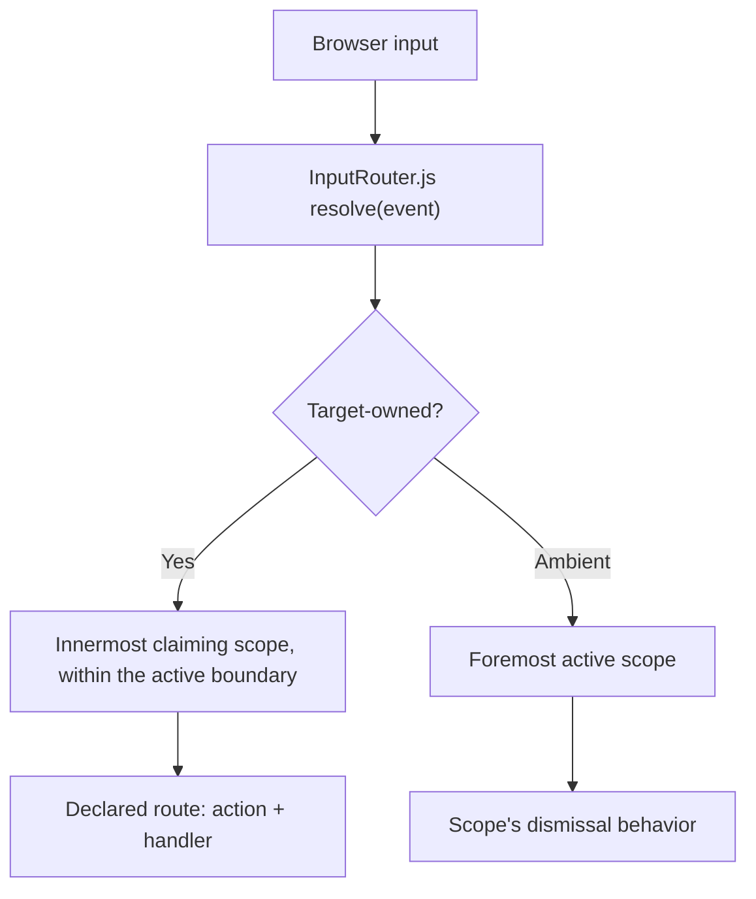

# Forma Input Router Design

## Scope

Input ownership and precedence across Forma components. Authoritative for
`InputRouter.js`, the `InputRoute`/`InputProfile`/`InputRouterOptions` records and the
binding and input records of each family in `Forma.Framework.Input`, the scoped
bridge in `Forma.Framework.Input.Interop` that carries host policy to the script, and every component's participation.

## Purpose

Forma components handle keyboard, pointer, wheel, focus, drag, drop, and dismissal input.
Handled independently, each behavior is correct in isolation, but nested components receive
the same input in the wrong order: an outer component acts before an inner component has an
opportunity to handle input that logically belongs to it.

This is not limited to key bindings or popups. It is a component-wide ownership problem:

> When components are nested, which component owns a particular input, and which
> components must defer?

Forma answers this once, through a shared router, rather than through per-component
exclusions, listener-registration order, or incidental event propagation.

## Decision summary

- `InputRouter.js` owns every routing decision, whichever listener carries the event to
  it.
- Components declare **routes** — a semantic action qualified by its owner, the bindings
  that raise it by default, and the handler — on a registered **scope**. Components
  implement actions and the router arbitrates ownership. The host remaps bindings by action.
- Targeted input is routed to the innermost scope on the event's composed path that claims
  that input, never past an active scope. Ambient input is routed to the foremost active
  scope only.
- Precedence among active scopes is topological alone: modal barrier, then parentage,
  then activation order, then registration order.
- Several behaviors register on one element and share one scope; each registration is
  disposed on its own, and the scope stays active while any registration holds it.
- Native editing controls carry an implicit profile defined per element and per input.
- `defaultPrevented` coordinates behaviors inside one scope; ownership between scopes is
  the router's.
- `FormaDialog` registers a modal scope and keeps native dialog semantics.
- Host policy and the host's own routes reach the script through a scoped .NET bridge,
  configured where the host registers the library, `AddFormaUIServer`,
  `AddFormaUIWebAssembly` or `AddFormaUIWebView`. A host route is
  answered once every component scope on the path has declined.
- The router stamps each active registration's element with its place in the ordering,
  `data-forma-layer`, for a surface outside the top layer to draw from; the visual order
  of the rest of the page is the page's.
- Every resolution is queryable: `resolve(event)` is the single result, and `owns` and
  `ownerOf` are views over it; `describe` and `stack` answer what a scope declares and how
  the scopes are ordered.

The governing rule:

> The router assigns targeted input to the innermost claiming scope within the current
> active boundary, and ambient input to the foremost active scope. Ancestor and underlying
> scopes do not receive the same routed action.

## Architecture

The router is one authority with two routing modes and several listener strategies.

- **Structural routing** resolves input that originates at a meaningful DOM target.
- **Active routing** resolves ambient input whose owner cannot be determined from the
  target alone.



### Authority over decisions, not over transport

Native event dispatch, pointer capture, passive wheel listeners, drag-enter/leave
sequencing, `DataTransfer`, focus behavior, and Blazor's event delegation have different
requirements. The router does not force them through one document dispatcher. Whether a
route's handler is invoked from a document listener or from a listener the router installs
on the scope is an implementation detail. What is fixed is that no component independently
arbitrates ownership.

### The two halves

| Part | Responsibility |
| --- | --- |
| `InputRouter.js` | Registers scopes and routes, resolves ownership synchronously from composed event paths, keeps the active ordering, installs whichever listeners each input class needs, applies `preventDefault` and propagation per resolution, and answers queries. |
| The .NET bridge | `InputRoute`, `InputProfile`, and `InputRouterOptions` records, with a binding record and an input record per family — keyboard, pointer, click, wheel, drop, a click's input described as a pointer's; a scoped service that transfers host policy, bindings, and host routes to the script once per user scope, before the first scope or routed interaction is registered. No component is mounted. |
| A participating component | Declares its scope and routes and implements the semantic actions. |

## Input scopes

An input scope is an independent interaction context that owns input originating within
it: a select list, a popup, a dialog, a grid, a sortable list, a tab list, an editor, an
active drag. Not every element with a handler is a scope.

A participating component registers on its root element with a profile:

```js
const registration = register(element, {
    modal: false,                        // declared, never inferred
    escape: 'dismiss',                   // 'dismiss' | 'cancel' | 'ignore'
    closeRequest: 'dismiss',             // the same choices; unstated, what Escape does
    pressAway: 'dismiss',             // 'dismiss' | 'ignore' | 'pass-through'
    boundary: ['keydown'],               // classes that stop here when no route matches
    parent: opener,                      // the scope this one stands inside; default: containment
    within: [trigger],                   // elements counted as inside
    onDismiss: dismiss,                  // (action, reason); unstated, the owner's HandleDismissAsync
    routes: [
        { action: 'select.next', bindings: [{ type: 'keydown', key: 'ArrowDown' }], handle: selectNext },
        { action: 'composer.bold', bindings: [{ type: 'keydown', key: 'b', modifiers: { primary: true } }], handle: bold },
        { action: 'track.scroll', bindings: [{ type: 'wheel', axis: 'vertical' }], handle: scrollTrack },
    ],
}, owner);                               // an optional .NET reference for actions implemented in C#
```

The first registration on an element creates its scope; later ones, from the behaviors
attached to the same element, add to it. A scope's routes are the union of its
registrations'; it is active while any registration holds it through `activate()`; and
disposing a registration removes only what it contributed. A disposed registration is
inert: activating or updating it does nothing, so a stale handle cannot put an orphan
into the active ordering.

A registration is validated when it is added and when it is updated: an unqualified
action, a binding that requires the primary modifier and requires it absent, a scope
named as its own parent, or a parent that would close a cycle through the scope are all
rejected, and a scope created for a rejected registration is not left behind. A parent
that is not yet registered is allowed and resolves once it is. The nearest registered scope
containing an element is found by scanning the registered scopes rather than through an
index the router would have to keep in step with the DOM.

### Actions and bindings

A route names a semantic action and the bindings that raise it by default. The action is
what the component implements and what the host remaps by; the bindings are what the
router matches.

An action identifier is a host-wide key, so it is qualified by its owner: `composer.bold`,
`select.next`, `tabs.next`, `app.search`. The router and `InputRoute` reject an unqualified
name, because a host override for `next` would otherwise remap every component that
happened to call something `next`. Two components that want to share one action share the
qualified name on purpose.

The host changes bindings per action, replacing the defaults, adding to them, removing
from them, or unbinding the action, without touching the component. The set it gives
replaces the set it gave before, so an action left out returns to its defaults:

```js
configure({
    bindings: {
        'composer.bold': [{ type: 'keydown', key: 'b', modifiers: { alt: true } }], // replace
        'select.next': { add: [{ type: 'keydown', key: 'j' }], remove: [...] }, // extend
        'composer.italic': null,                                              // unbind
    },
});
```

`describe` reports each route's default bindings, its effective bindings, and which of the
two is in force.

### Matching

A binding is matched by the rules of its family:

| Family | Matches by |
| --- | --- |
| Keyboard (`keydown`, `keyup`) | The key, compared without regard to case; Control, Meta, and Alt absent unless stated; Shift either way unless stated. A typing binding names no key and matches any printable character other than a space, one composed through AltGr included, for type-ahead; a binding naming the key is more specific and wins |
| Pointer (`pointerdown`, `pointerup`, `pointermove`) | The button that changed, the buttons held (for a move during a gesture), the device (`mouse`, `pen`, `touch`), and only the modifiers it states |
| Click (`click`, `dblclick`) | The button, and only the modifiers it states; dispatched on the click itself, so one raised from the keyboard, with no press before it, resolves like any other |
| Wheel | The axis the turn mostly moves along, and only the modifiers it states |
| Drop (`drop`, `dragover`) | Any of the data kinds it names, as the drag's data transfer lists them |

Modifiers are stated in a binding's `modifiers`; `primary` stands for Command on Apple platforms and Control elsewhere. A binding may add a
`when(event)` predicate for what the vocabulary cannot say. A key pressed during
composition, through an input method editor or a dead key, is routed to nothing.

When several bindings on one scope match, the most specific wins, so a plain ArrowDown
never takes Shift+ArrowDown from the binding that names Shift. Among equally specific
bindings the route's `priority` decides, and among equal priorities registration order
does; the resolution names which of the three decided, so registration order is never a
hidden rule.

A handler is a script function, `handle(event, { action, owner, binding })`, or the router
invokes the .NET owner with the resolved action: `HandleInputActionAsync(action, input)`,
where the input is described by its family so the owner reads it as the matching record.
The record carries the input, never the element it landed on, so a route whose action
depends on which element was pressed — which item of a list — is handled in script, which
tells its owner which one. The handler runs from whichever listener resolved the event —
the document's for a key, an outer scope's for a press that an inner scope owns — so it
takes the owning element from the routing it is given, never from `event.currentTarget`; a
gesture that captures the pointer captures it on `owner`.

A consumed input prevents its default and stops at the scope by class default — a key or a
wheel turn does both, a key release stops without preventing, a press and a click do neither,
a drop prevents its default and continues — unless the route says otherwise. Where a route mixes
classes, each binding takes the default of its own class.

### Implicit native scopes

Native editing controls are protected even when a host places them inside a Forma
component without registering a scope. The router carries a table, **per element and per
input**, of what the control consumes natively:

| Element | Consumes |
| --- | --- |
| `input` (text-like types) | Typing, Home, End, ArrowLeft/Right, Shift+Arrow, Ctrl+Arrow, Enter, Backspace, Delete, Ctrl+A/C/V/X/Z/Y |
| `input[type=number]` | The above plus ArrowUp/Down and wheel while focused |
| `textarea` | The text-like `input`'s keys plus ArrowUp/Down, PageUp, PageDown, and wheel when it scrolls |
| `input` (date and time types) | Typing, every arrow, Enter, Backspace, Delete |
| `input[type=range]` | Arrows, Home, End, PageUp, PageDown |
| `input[type=radio]` | Arrows, Space |
| `input[type=checkbox]` | Space |
| `select` | Arrows, Home, End, PageUp, PageDown, typing, Enter, Space |
| `button`, button-like `input` types, `a[href]`, `summary`, `[role=button]`, `[role=link]` | Enter, Space |
| `video[controls]`, `audio[controls]` | Arrows, Home, End, Enter, Space |
| `[contenteditable]` | Typing, every arrow, Home, End, PageUp, PageDown, Enter, Backspace, Delete, the editing shortcuts, Ctrl+B/I/U, wheel when it scrolls |
| Any element that scrolls on its own | Wheel along the axis it scrolls |

A click on any of the controls that own their own press — a link, a button, a form control, a
label, an element with the role of a button or a link, an editable region — is that control's
activation, so a route on a scope around it never takes the click.

A disabled control consumes nothing. Input a native control consumes is owned by that control. Input it does not consume —
Escape, an unrelated shortcut, wheel on a control that does not scroll — resolves through
the enclosing scopes as usual. A component that needs a shortcut to work inside its own
editable declares that shortcut as a route on the editor's scope; nothing is exempted
globally.

### A field's pending edit

A text field reports its value as each character is typed or, where its component updates on
change, as it commits its edit, which the browser does as the field loses the focus. An action
the router routes, or a dismissal, while the field holds the focus would run before that commit,
so the router first commits the focused field's pending edit, raising its change event, and the
action reads the text as it stands. The change the browser raises for that edit as the field
loses the focus is held back, so an edit reports its change once. A field whose last edit already
reported its change is left as it is, and a key the field consumes commits nothing.

## Structural routing

Applies to navigation keys, Tab, shortcuts while focus is within a scope, wheel, pointer
gestures, clicks, drag and drop targets, and Enter and implicit submission.

### A press and its click

A click follows the press it ends, and belongs with it. A press resolves its scope and may
begin a gesture without committing anything a click would; the click then dispatches its own
route. A registration that claims the gesture a press began — a drag under way, a press away
that dismissed something — marks the click that follows it swallowed: the next click from the
same pointer, on what was pressed or on the element that captured the pointer, within a
moment of the release. Any other click from a pointer ends the claim unswallowed, and a click
raised from the keyboard follows no press, so it is never swallowed. A click whose press stood
in a scope that has since gone, or turned inactive, belongs to nothing rather than falling to
the scope beneath it.

`resolve` walks `event.composedPath()` from the target outward. `composedPath()` rather than
`target.closest(...)`, so retargeting and shadow boundaries do not break resolution, and so
a top-layer popover still resolves through its opener.

The walk stops at the first route that matches, at a native control that consumes the
input, or at a boundary: a scope that declares itself one for the input's class, and every
active or modal scope for every class. A popup with plain content inside a grid does not
hand ArrowDown to the grid: the popup is active, so input inside it stays inside it. A scope
that routes only Enter does not stop Ctrl+K from reaching the host unless it declares a
keyboard boundary. If the walk reaches a boundary, the browser performs its default
behavior, and the resolution names the boundary as owner with no action; the input does
not fall into an ancestor component action.

Capture-phase listeners cannot wait for a descendant to set `defaultPrevented`. Any
listener the router installs in capture acts only on the resolved owner. So a grid does not
interpret ArrowDown when the event belongs to a nested select scope.

## Active routing

Applies to Escape dismissal or cancellation, a press away, native dialog cancellation and
other platform close requests, cancellation of an active drag, and temporary focus-return
interactions.

A registration enters the active ordering through `activate()` and leaves through
`release()`. The ordering holds registrations, not scopes: two behaviors active on one
element are two entries, each with its own activation, its own ambient settings, and its
own dismissal handler. Only the foremost active registration receives an ambient action.
If it declines or ignores the action, the router does not offer it to a registration
underneath, so one press never dismisses two interactions.

### Precedence

Foremost is decided in this order, and a later rule never overrides an earlier one:

1. **Modal barrier.** Only the topmost modal scope and the scopes whose parent chain
   reaches it are eligible. An unrelated scope activated after the modal stays beneath it.
2. **Parentage.** An active scope inside another active scope outranks it. A scope's
   parent is the one it declares, else the nearest registered scope containing it; a
   drag or a portal that stands outside its opener in the DOM declares the opener.
3. **Activation order.** Among siblings, the most recently activated is foremost.
4. **Registration order.** The deterministic fallback.

A popup open behind a newly opened modal dialog is not foremost. A drag started inside a
popup outranks that popup by parentage; the same drag behind a modal opened over it does
not outrank the modal. There is no named priority: nothing a component or a host declares
can outrank parentage, modality, or actual activation.

### Nested popup

1. An outer popup opens and activates.
2. An element inside it opens an inner popup, which activates above it by containment.
3. Escape closes the inner popup and returns focus to its trigger inside the outer popup.
4. A second Escape closes the outer popup and returns focus to its own trigger.

### Drag inside a popup

1. The popup is active.
2. A drag begins inside it and activates a temporary interaction above the popup.
3. Escape is routed to the drag, which cancels. The popup remains open.

### Focus-return interactions

`FormaComposer`'s selection bar is active only while it has focus, from focus-in to
focus-out; Escape then returns focus to the editor. It is never active merely because it is
visible.

## `defaultPrevented`

| Mechanism | Role |
| --- | --- |
| The router | Decides ownership between scopes, and between the routes of one scope, by specificity and priority. |
| `defaultPrevented` | Tells a listener outside the router — a Blazor handler, a native default — that the router already answered the input. |

The router does not consult `defaultPrevented`: its document and scope listeners run in
the capture phase, before anything could have set it, and rival claims inside one scope
are settled by specificity, priority, and the reported tie rather than by who ran first.
A nested surface routes Tab on its own scope, and the focus interaction routes as well; nothing
relies on `defaultPrevented` as the protection against an ancestor, least of all where
capture-phase or document listeners run first.

## Dialog integration

`FormaDialog` registers a scope with `modal: true` while open; modality is declared in the
profile it registers, since `showModal()` leaves no DOM trace. The dialog keeps native
modality, background inertness, focus containment, top-layer rendering, and native close
requests.

Two entry points feed the router:

- Escape arrives as a keydown the router sees first. If a scope is active above the dialog,
  the press is consumed there and the dialog never receives its `cancel`.
- A platform close request — a back gesture, an assistive-technology dismiss — arrives only
  as the dialog's `cancel` event, which does not bubble. The router hears it in the capture
  phase at the document and offers it through `requestDismiss(dialog, 'close-request')`, so
  `Dialog.js` stays unaware of the router. The request enters at the dialog but resolves to the foremost active
  registration: the dialog when it is foremost, else the popup or drag above it, which is
  dismissed instead. Either way the decision says to prevent the native cancellation, so
  the dialog never closes underneath what stands above it.

A dismissal reaches its registration as the action it declared, `dismiss` or `cancel`, and
the reason that raised it: `escape`, `press-away`, or `close-request`.

Escape already answered by the router never closes the dialog as a second action.

## Popover integration

`FormaPopover` registers its root and activates while open, and carries its content's routes
on that registration, so a select's or a menu's list keys are declared through the popover
rather than on a scope of the list's own. Its options remain its own:
whether it keeps focus within itself (`KeepsFocus`), whether closing returns focus to its
trigger (`ReturnsFocus`), whether a press away dismisses it (`PressAway`), and how open
state is reported. A press away passes through: it dismisses the popover and then belongs to
whatever was pressed, so one press on another control closes the popover and acts on the
control, and a press on another popover's trigger swaps the popovers. It has no document Escape
listener and no scrim of its own; the trigger is declared `within`,
so a press on it toggles rather than dismisses.

## Focus and Tab

The router decides which scope owns Tab; it does not replace focus behavior. The focus
interaction declares the keys it answers as routes on the surface it is attached to, `focus.next`,
`focus.previous`, `focus.first` and `focus.last`: Tab and Shift+Tab on a wrapping or
arranged surface, and the arrows along the axis, Home and End on a roving one, each matching
only where the surface has a control to send focus to, so a Tab past the end of an arranged
surface with nothing after it is left to the browser. A profile carries no focus setting of
its own. Native dialogs contain focus, and `FormaSelect` closes on Tab through a route its
popover's registration declares, since a popover that does not keep focus routes no Tab of
its own. Closing an inner interaction returns focus to its own trigger without disturbing the
containing interaction.

## Visual stacking

Visual state contributes to resolution — a top-layer element's order, `:popover-open`,
`dialog[open]` — and the router stamps each active registration's element with its place
in the ordering as `data-forma-layer`, for anything not in the top layer to draw from. The
router does not guarantee visual order for arbitrary
DOM: CSS `z-index` cannot escape a stacking context, browser top-layer order is not
controlled by CSS, and re-showing a top-layer element to reorder it moves focus and fires
lifecycle events. Behavioral order and visual order are meant to agree; they are not the
same mechanism.

## Configuration

Three roles, not an override chain:

| Role | Holds | Who sets it |
| --- | --- | --- |
| Router invariants | The modal barrier, structural isolation, one ambient owner, the native table | The router; not configurable |
| Host policy | Application-wide defaults (what a press away does, what Escape does, what a close request does); the bindings it remaps by action; its own routes, answered through its `IInputActionHandler` — `Routes` once every component scope has declined, `PreemptiveRoutes` before anything local | `InputRouterOptions` through `AddFormaUIServer`, `AddFormaUIWebAssembly` or `AddFormaUIWebView` |
| Scope profiles | A component's capabilities, its actions with their default bindings, its local dismissal behavior | The component, exposing to its host only what a host would reasonably choose |

The resolver combines them into one decision. A host cannot casually override an invariant;
a component default does not silently defeat explicit host policy.

### Preemptive routes are absolute

A preemptive route takes the input from every local claim: component routes, native
controls, active boundaries, and modal boundaries. Only Escape and a press away, being
ambient, are resolved before it, and the order in which resolution happens is fixed:
ambient, then preemptive, then structural. Route priority never compares a preemptive
route with a structural one, because they are never candidates together. The name is
meant to read that strongly: a preemptive route is an application command that nothing on
the page may keep, such as a command palette. A host route that should yield to whatever
is under the cursor goes in `Routes`, which are the fallback after every scope has declined.

### Close requests

A platform close request — a dialog's `cancel`, a back gesture, an assistive-technology
dismiss — is its own ambient input with its own setting, `closeRequest`, on the
registration and on the host. Unstated, it does what Escape does, so a scope that ignores
Escape ignores close requests too unless it says otherwise. A close request is honored
only from a scope that is active; a stale request from a registered but inactive element
dismisses nothing.

## Queryability

```js
resolve(event) => { owner, scope, registration, route, binding, input, action, handler, preventDefault, propagation, precedence, source, tie, reason }

owns(element, event)      // is element's scope the resolved owner
ownerOf(event)            // the resolved owner
requestDismiss(element, reason)   // offers a close request raised at element to the foremost registration, and says whether it was forwarded
describe(element)         // the routes with default and effective bindings, the active registrations, and the place in the ordering
stack()                   // the active ordering, foremost last, with the rule that placed each registration
```

`precedence` is `preemptive`, `structural`, `native`, `active`, or `none`; `reason` names the
route, the native control, the boundary, the ambient input, or why nothing owns it; `tie`
names what decided between rival bindings; `source` says whether the winning route's
bindings are its defaults or the host's. A boundary is reported as owner with no action,
so a question about an input the router deliberately left alone still has an answer, and
`FormaInputInspector` shows the resolutions live.

## Conflict resolution matrix

| Conflict | Mode | Owner |
| --- | --- | --- |
| Select in a grid cell receives ArrowDown | Structural | `FormaSelect` |
| Emoji-picker search receives Ctrl+B | Structural | `FormaEmojiPicker`'s scope |
| Popup content receives wheel over a toolbar | Structural | The popup's scope |
| Drag inside a popup receives Escape | Active | The drag |
| Folder node receives a drop inside the sidebar | Structural | The folder tree's zone, which names the folder row under the drop |
| Inner popup receives Escape | Active | The inner popup |
| Popup in a dialog receives Escape | Active | The popup |
| Dialog opened over a popup receives Escape | Active | The dialog |
| Host `<input>` in a grid receives arrows | Structural, implicit | The input |
| Tab list receives arrows | Structural | `FormaTabs` |

The explorer's folder rows are the targets of one zone on the folder tree rather than a
scope each: a scope per row would cost a round trip per folder on every explorer render, so
the tree registers once, matching only the data kinds it accepts, and its script finds the
row under the drop and tells the sidebar that folder's key. A drop a nested scope routes
still never reaches the zone around it.

### A press observed, not owned

Every key, press, wheel turn, click and drop a component acts on is a route or an active
registration, with one kind of exception: a press a component only observes. A window
comes to the front on any press inside it, whoever owns that press — a splitter's resize,
a drag, a selection — so a route on the window would never hear the presses its content
routes. The window listens for them itself, and neither prevents their default nor stops
them, so the press stays the owner's. Observing never decides who acts on an input, which
is the one thing the router is there to decide.

## Non-goals

The router does not implement what an action does inside a component, replace the focus
interaction, `DragGesture`, `PanGesture`, or selection behavior, turn every DOM event into a .NET
callback, reimplement native dialog modality or focus trapping, or promise visual order
for DOM it does not manage.
